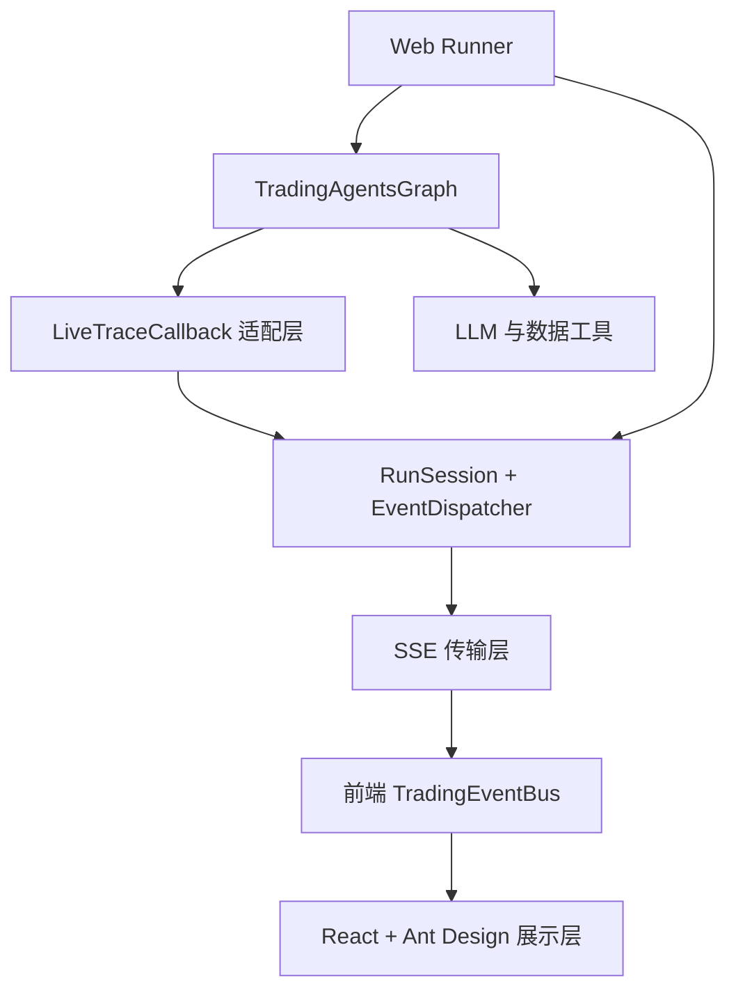
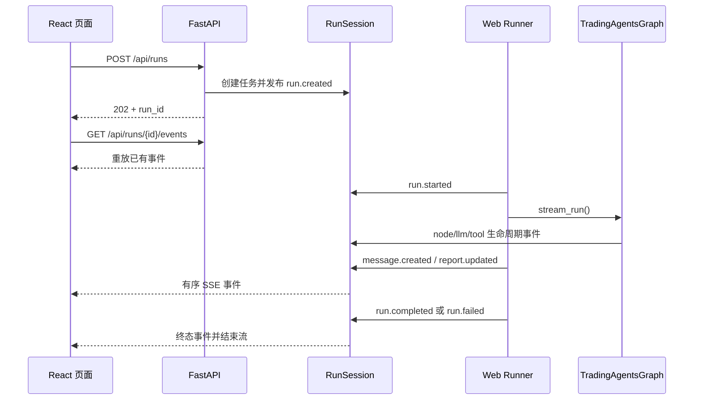

# TradingAgents Web 设计说明

## 1. 设计目标

Web 层不是重新实现一套交易分析系统，而是给现有 `TradingAgentsGraph`
增加一个可观察、可交互的运行界面。因此设计时遵循以下原则：

1. **复用核心业务图**：CLI 和 Web 都调用同一个 `TradingAgentsGraph`，Agent、工具、辩论和决策逻辑只维护一份。
2. **事件优先**：执行器只负责产生事实事件，页面通过订阅事件更新状态，不让业务执行器依赖具体 UI。
3. **可恢复观察**：事件保留递增序号，页面刷新或 SSE 重连后可以重放，不因短暂断线丢失中间过程。
4. **兼容演进**：事件信封带 `schema_version`，同时保留旧的扁平载荷字段，使前后端可以逐步升级。
5. **凭证不出服务端**：浏览器只能看到供应商、模型、凭证是否存在以及环境变量名称，永远看不到 API Key 值。
6. **不暴露隐藏推理**：只展示 LangChain/LangGraph 已公开的消息、工具输入输出、报告和状态，不尝试读取模型内部思维链。

## 2. 总体分层



各层职责保持单一：

- `TradingAgentsGraph`：原有领域逻辑和多 Agent 编排。
- `runner.py`：把一次 Web 请求转换成图配置，执行图并发布领域事件。
- `LiveTraceCallback`：把 LangChain Callback 翻译成统一事件。
- `RunSession`：保存任务状态、事件历史和 SSE 等待条件。
- `EventDispatcher`：在服务端按主题调用注册处理器。
- SSE：只负责把有序事件从服务端传到浏览器。
- `TradingEventBus`：在浏览器内再次按主题分发。
- React：订阅事件并把事件归约成可渲染状态。

## 3. 为什么使用 SSE

当前交互以“服务端持续推送、浏览器偶尔发起创建或取消请求”为主，数据方向高度不对称，因此使用 SSE 而不是 WebSocket：

- 浏览器原生支持 `EventSource`，不需要额外协议库。
- 天然支持事件 ID 和自动重连。
- 普通 FastAPI 流式响应即可实现，部署和调试成本低。
- 创建任务、取消任务继续使用清晰的 HTTP API。

SSE 不负责强实时双向控制。若以后需要运行中向 Agent 注入消息、人工审批或动态修改计划，再考虑增加 WebSocket 或独立命令通道。

## 4. 统一事件模型

所有事件都使用同一个信封：

```json
{
  "schema_version": 1,
  "id": 12,
  "type": "tool.started",
  "family": "tool",
  "phase": "start",
  "timestamp": "2026-10-27T10:00:00+00:00",
  "session_id": "analysis-run-id",
  "correlation_id": "langchain-call-id",
  "topics": [
    "tool.started",
    "agent.role.analyst.tool.started"
  ],
  "agent": {
    "id": "market_analyst",
    "name": "Market Analyst",
    "role": "analyst"
  }
}
```

字段的设计意图：

- `type`：最精确的事件判别字段，适合 reducer 或 `switch`。
- `family`：把 `tool.started`、`tool.completed` 归到 `tool` 事件族。
- `phase`：把不同事件族统一成 `start/update/end/error` 生命周期。
- `id`：任务内严格递增，用于重放、去重和断线续传。
- `session_id`：区分不同分析任务。
- `correlation_id`：关联一次 LangChain 节点、模型或工具调用的开始与结束。
- `topics`：支持按角色、Agent、多空方向和事件类型订阅。
- `agent`：把不稳定的显示名称归一化为稳定 ID 和业务角色。

事件信封和具体载荷保持分离。例如工具事件额外包含 `tool_call_id`、
`tool`、`input`、`output`、`duration_ms` 和 `is_error`，而报告事件包含
`report_key`、`title` 和 `content`。

## 5. 主题订阅设计

订阅器使用简单 glob 模式，既能精确订阅，也能按业务维度聚合：

```text
tool.started                 只处理工具开始
tool.*                       处理完整工具生命周期
agent.started                处理任意 Agent 开始
agent.role.analyst.*         处理所有分析师活动
agent.side.bull.*            处理多头研究员活动
agent.side.bear.*            处理空头研究员活动
agent.portfolio_manager.*    处理投资组合经理活动
*                            处理全部事件
```

服务端和浏览器采用相同的订阅语义，并都返回取消订阅函数：

```python
stop = session.subscribe("tool.started", audit_tool_call)
stop()
```

```ts
const stop = tradingEvents.subscribe('agent.side.bull.*', handleBullEvent)
stop()
```

这样新增日志、审计、通知、费用统计或独立 UI 面板时，只需注册处理器，不需要修改事件生产者。

## 6. 运行与事件时序



事件先写入 `RunSession.events`，再调用本地处理器。这样即使某个处理器失败，事件仍然已经进入历史，并可以继续通过 SSE 发送。

## 7. 前端状态管理思路

页面没有在 `EventSource.onmessage` 中堆叠大量条件判断。处理步骤是：

1. `EventSource` 解析 JSON。
2. 按事件 `id` 去重。
3. 将事件投入共享 `TradingEventBus`。
4. 不同订阅器分别更新任务状态、Agent 状态、报告和最终结果。
5. React 再从这些基础状态派生指标、阶段进度和过滤后的时间线。

这是一种轻量事件归约方式。以后拆分页面组件时，每个组件可以只订阅自己关心的主题，而不必接收整个运行对象或层层传递回调。

时间线最多保留最近 500 条事件，防止长任务让浏览器状态无限增长；服务端文本和集合也有大小上限，避免单个工具结果占用过多内存。

## 8. 并发与线程安全

一次分析在后台守护线程运行，FastAPI 请求线程可以立即返回任务 ID。线程安全策略包括：

- `RunRegistry` 使用锁保护任务集合和全局订阅器。
- `RunSession` 使用 `Condition` 原子保护状态和事件列表。
- SSE 没有新事件时在 `Condition.wait()` 阻塞，而不是轮询。
- 发布事件时只在锁内追加和通知，在锁外执行用户处理器和 JSON 编码。
- LangChain 重复 Callback 通过 `(event_type, run_id)` 去重。

当前限制一个分析任务同时运行，主要考虑模型费用、第三方 API 限流和进程级配置隔离。若以后支持并发，应把资源额度、每用户队列和持久化任务状态一起设计，而不只是删除这个限制。

## 9. Provider 与凭证安全

Web UI 不直接接受或保存 API Key。服务端执行以下流程：

1. 读取共享模型目录。
2. 读取 provider 对应的环境变量名称。
3. 只判断变量是否存在。
4. 默认选择第一个已经配置凭证的 provider。
5. 创建任务前校验 provider 与模型是否匹配。
6. runner 用已解析值覆盖默认模型配置。

`/api/meta` 只返回 `configured: true/false` 和 `credential_env` 名称，不返回环境变量值、后端鉴权头或带凭证 URL。

## 10. 兼容性与扩展方式

新增事件时推荐遵循以下约定：

```python
session.publish(
    "portfolio.alert",
    agent_name="Portfolio Manager",
    severity="warning",
    message="Position limit reached",
)
```

- 使用 `名词.生命周期` 或 `领域.动作` 的小写点号格式。
- 可以关联 Agent 时提供 `node` 或 `agent_name`。
- 可以形成开始/结束对时提供稳定 `correlation_id`。
- 载荷必须能够 JSON 序列化，不应包含凭证或隐藏推理。
- 新字段应保持可选，避免旧前端解析失败。

前端无需修改 SSE 连接层，只需订阅：

```ts
tradingEvents.subscribe('portfolio.*', handlePortfolioEvent)
```

## 11. 当前取舍与后续演进

当前版本有意保持本地工具所需的最低复杂度：

- 任务和事件保存在内存，服务重启后不会保留。
- 服务端处理器同步执行，耗时处理应自行投递队列。
- SSE 是单向的，取消请求通过单独 HTTP API 完成。
- 取消是协作式的，不能中断已经发出的同步模型或工具请求。
- 事件重放只覆盖仍保留在内存中的最近任务。

如果需要面向多用户或生产部署，建议按优先级增加：

1. 持久化事件存储和任务恢复。
2. 用户身份、任务所有权和接口鉴权。
3. 异步任务队列及并发额度控制。
4. 服务端异步事件处理器和失败重试。
5. token、费用、工具耗时等可观测指标聚合。
6. 人工审批和运行中指令通道。

这些扩展都可以继续复用当前事件信封和订阅模型，不需要改写核心 `TradingAgentsGraph`。
